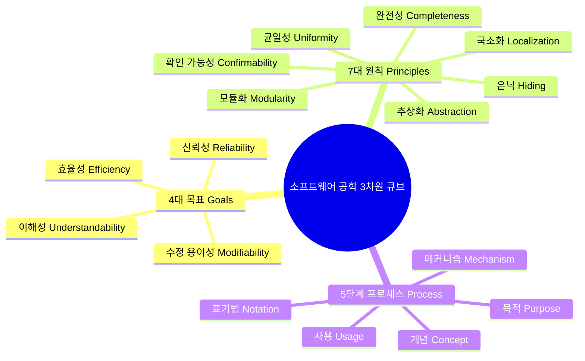
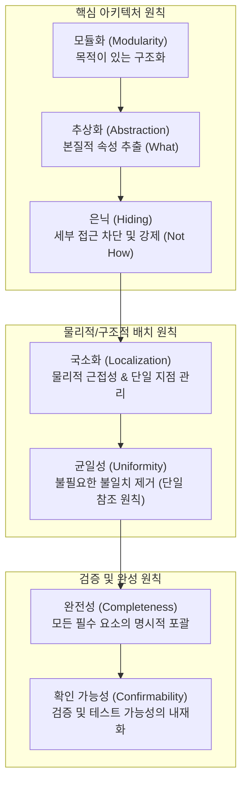
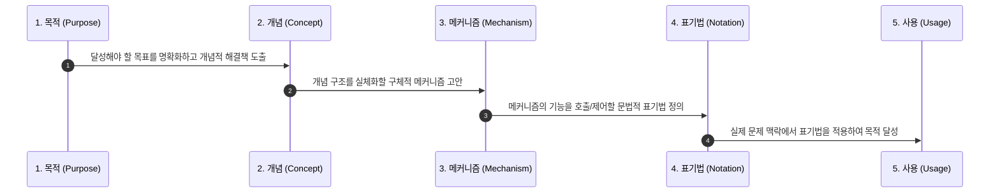
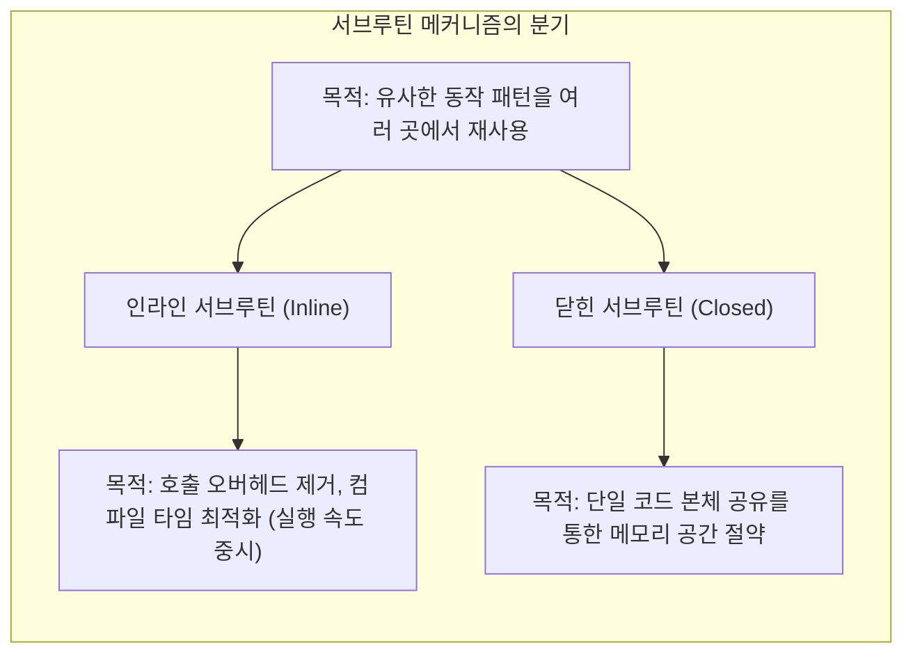
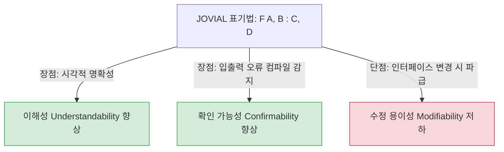

# [심층 분석 백서] 소프트웨어 공학: 과정, 원칙, 그리고 목표 (1975)

> **원제**: *Software Engineering: Process, Principles, and Goals*  
> **저자**: Douglas T. Ross, John B. Goodenough, C. A. Irvine (*SofTech, Inc.*)  
> **발표**: IEEE Computer Society, *Computer*, Vol. 8, No. 5 (May 1975, pp. 17–27) [DOI: 10.1109/C-M.1975.218952](https://doi.org/10.1109/C-M.1975.218952)  
> **문서 성격**: 1975년 고전 텍스트의 핵심 이론을 체계적으로 복원하고, 1차 원전 사료 계보와 레드팀 비평(Red-Team Review)을 접목하여 현대 시스템 공학 관점에서 재평가한 종합 분석 백서.

---

## 1. 역사적 배경과 문제의식

### 1.1 '소프트웨어 위기(Software Crisis)'의 도래
1960년대 중후반, 메인프레임 컴퓨터 하드웨어의 처리 속도와 용량은 비약적으로 발전했으나, 그 위에서 작동하는 소프트웨어는 극심한 혼돈 상태에 빠져 있었습니다.
* 막대한 비용과 시간이 투입되었음에도 일정 지연, 예산 초과, 잦은 시스템 다운이 일상화되었습니다.
* 개발자 본인조차 수개월 전에 작성한 코드를 읽고 수정하지 못하는 **'스파게티 코드(Spaghetti Code)'** 현상이 속출했습니다.
* 1968년과 1969년 독일 가르미슈(Garmisch)와 로마에서 개최된 **NATO 소프트웨어 공학 컨퍼런스**를 기점으로, '소프트웨어 공학'이라는 용어가 공식적으로 대중화되었습니다. 주먹구구식 코딩(Hacking)을 탈피하여 건축이나 토목처럼 엄밀한 공학적 규율(Discipline)을 수립해야 한다는 절박한 요구가 분출했습니다.

### 1.2 1975년 논문의 역사적 의의
Douglas T. Ross, John B. Goodenough, C. A. Irvine은 소프트웨어 개발이 맞닥뜨린 복잡성을 체계적으로 해체하고 정복하기 위해 **소프트웨어 공학의 3차원 기본 블록(The Building Blocks of Software Engineering)** 프레임워크를 제안했습니다. 이 논문은 개별 기법(컴파일러, 고수준 언어, 프로그래밍 기법 등)의 나열을 넘어, 소프트웨어 공학 전체를 관통하는 **4대 목표, 7대 원칙, 5단계 프로세스**의 상호작용 매트릭스를 정립한 기념비적 고전입니다.



> [!NOTE]
> **레드팀 분석: 1968년 이전 소프트웨어 '무법지대' 신화의 해체**  
> 흔히 1968년 이전의 초기 컴퓨팅을 "체계도 규율도 없는 완전한 스파게티 암흑기"로 묘사하곤 하지만, 이는 사후적 역사 재구성(Historical Retconning)에 가깝습니다.
> * **선행 구조화 체계**: 이미 **COBOL-60(1959~1960)**은 `Data Division`과 `Procedure Division`의 엄격한 관심사 분리를 강제하고 계층적 레코드(`01`, `05`)를 지원했습니다. **ALGOL 60**은 블록 구조(`begin...end`), 렉시컬 스코프, BNF 문법 정의를 확립했으며, **SAGE 프로젝트(1950년대)**는 중앙 컴풀(Compool) 테이블과 엄격한 인터페이스 제어 문서(ICD) 하에 수십만 라인의 실시간 시스템을 성공적으로 운용했습니다.
> * **위기의 진정한 본질**: 소프트웨어 위기는 방법론의 전무 때문이 아니라, IBM System/360 등 3세대 컴퓨터 보급으로 하드웨어 용량이 폭증하면서 요구되는 시스템 규모가 수천 라인에서 수백만 라인으로 급팽창한 **하드웨어-소프트웨어 스케일링 불균형(Capacity-Complexity Mismatch)**에서 비롯되었습니다. NATO 컨퍼런스는 무에서 유를 창조한 것이 아니라, 학술적·산업적 규율의 필요성을 공식 제도권으로 끌어올린 분수령이었습니다.

---

## 2. 3차원 빌딩 블록 (The 3D Cube Model)

논문은 소프트웨어 공학의 모든 활동을 3개의 직교하는 축으로 구성된 **큐브 모델**로 정의합니다.

```
                    ┌─────────────────────────────────────────┐
                   ╱                 PROCESS                 ╱│
                  ╱   (Purpose, Concept, Mechanism,         ╱ │
                 ╱     Notation, Usage)                    ╱  │
                ┌─────────────────────────────────────────┐   │
                │                                         │   │
                │              PRINCIPLES                 │ G │  UNDERSTANDABILITY
                │                                         │ O │  RELIABILITY
                │   • Modularity       • Uniformity       │ A │  EFFICIENCY
                │   • Abstraction      • Completeness     │ L │  MODIFIABILITY
                │   • Localization     • Confirmability   │ S │
                │   • Hiding                              │   │
                │                                         │  ╱
                │                                         │ ╱
                └─────────────────────────────────────────┘╱
```

1. **프로세스 축 (Process)**: 인간의 지성이 문제를 분해하고 해결해 나가는 5단계 논리적 경로
2. **원칙 축 (Principles)**: 시스템을 구조화하고 인터페이스를 통제할 때 적용하는 7가지 설계 나침반
3. **목표 축 (Goals)**: 최종 소프트웨어가 지녀야 할 바람직한 4가지 공학적 속성

소프트웨어 시스템의 모든 설계 선택(Design Choice)은 큐브 상의 특정 좌표점 **(프로세스 단계 × 적용 원칙 × 달성 목표)** 에 위치하며, 한 지점의 선택이 다른 좌표점들에 어떤 연쇄 작용과 트레이드오프를 유발하는지 추적할 수 있습니다.

> [!WARNING]
> **레드팀 분석: 3차원 큐브의 '직교성(Orthogonality)'과 선형 독립의 한계**  
> 저자들은 큐브의 세 축이 독립적으로 교차한다고 설명하지만, 실제 공학 실무에서 이 세 축은 **수학적 직교 벡터 공간을 이루지 못합니다**.
> 1. **원칙 간의 충돌**: '은닉(Hiding)'은 내부 가시성을 차단하여 '확인 가능성(Confirmability)'과 화이트박스 테스트를 저해하며, '국소화(Localization)'는 시스템 전반의 '균일성(Uniformity)'과 마찰을 빚습니다.
> 2. **원칙 간의 비대칭 종속**: 모듈화(Modularity)라는 목적 있는 구조화가 선행되지 않으면 추상화나 국소화 논의 자체가 성립할 수 없습니다.
> 따라서 큐브 모델은 수학적 선형 독립이라기보다는, 복잡한 설계 과업을 다각도에서 점검하기 위한 **'인지적 관심사 분리(Separation of Concerns) 체크리스트'**로 이해하는 것이 정확합니다.

---

## 3. 소프트웨어 공학의 4대 기본 목표 (The Four Goals)

공학 도구와 방법론의 숙련도는 '목적의 선명도'에 의해 좌우됩니다. 논문은 결과물 소프트웨어가 만족해야 하는 4대 근본 목표를 규정합니다.

<div class="table-wrapper" data-scroll-hint="좌우로 스크롤하여 확인" tabindex="0" role="region" aria-label="소프트웨어 공학 4대 기본 목표 정의">
<table>
<thead>
<tr>
<th style="min-width: 120px; text-align:left;">목표</th>
<th style="min-width: 140px; text-align:left;">영문</th>
<th style="min-width: 450px; text-align:left;">핵심 정의 및 논문의 통찰</th>
</tr>
</thead>
<tbody>
<tr>
<td><strong>이해성</strong></td>
<td>Understandability</td>
<td><strong>복잡성 극복의 절대적 전제조건.</strong> 시스템의 개념 구조가 인간의 인지 한계 내에서 파악 가능한 상태. 가독성(Legibility) 수준을 넘어 전체 아키텍처의 의도가 명료하게 투영되어야 함.</td>
</tr>
<tr>
<td><strong>신뢰성</strong></td>
<td>Reliability</td>
<td><strong>설계 초기부터 내재화되어야 하는 성질.</strong> 개념 구상부터 결함을 예방하고, 운영 중 예외 발생 시 회복할 수 있는 능력. 사후에 테스트나 패치로 덧붙일 수 없음.</td>
</tr>
<tr>
<td><strong>수정 용이성</strong></td>
<td>Modifiability</td>
<td><strong>인간이 정복하기 가장 어려운 목표.</strong> 전체적인 논리적 불변성(Invariance)을 엄격히 통제하면서, 원하는 국소적 부분만을 안전하게 변경할 수 있는 능력.</td>
</tr>
<tr>
<td><strong>효율성</strong></td>
<td>Efficiency</td>
<td><strong>가장 남용되기 쉬운 목표.</strong> 미성숙한 최적화(Premature Optimization)를 경계해야 함. 구조적 결함 속에서 비트를 쥐어짜는 것보다, 올바른 추상화와 균일한 구조가 장기적 효율성을 극대화함.</td>
</tr>
</tbody>
</table>
</div>

### 3.1 심층 분석: 왜 '수정 용이성'이 가장 어려운가?
논문은 수정 용이성을 단순한 '코드 다시 짜기'가 아니라 **"불변성(Invariance)의 제어"**로 정의합니다.
* 예: 소프트웨어를 새로운 하드웨어로 이식할 때, 시스템의 수학적/논리적 기능은 **완벽히 불변**이어야 하며, 오직 머신 종속적인 인터페이스만 변경되어야 합니다.
* 전체의 무결성을 깨뜨리지 않고 특정 요소만 '젠가 블록'처럼 안전하게 빼내어 교체하는 작업은 인간의 인지적 통제력을 극도로 요구하기 때문에 역사상 가장 달성하기 힘든 목표로 평가됩니다.

> [!NOTE]
> **레드팀 분석: 4대 목표에 대한 현대적 재평가**  
> * **이해성의 이분법 도그마 비판**: 논문은 *"이해성은 존재하거나 존재하지 않거나 둘 중 하나다(There is no middle ground)"*라고 단언하지만, 이는 리눅스 커널(3,000만 줄)이나 크로미움(3,500만 줄)과 같은 현대 거대 복잡계에서는 성립 불가능한 이상주의입니다. 현대 공학의 실체는 단일 인간의 100% 완전한 이해가 아니라, **'타입 계약과 불변식 기반의 한정된 부분적 이해(Bounded Partial Understanding)'**와 동료·도구 간 분산 인지(Distributed Cognition)입니다.
> * **수정 용이성 최고 난도설의 현대적 역전**: 1975년 당시 수정 용이성이 최고 난도로 꼽힌 본질은 인간 두뇌 한계라기보다 **Git, 자동 테스트 스위트, CI/CD, 피처 플래그가 전무했던 '도구 결핍(Tooling Vacuum)'** 때문이었습니다. 현대 엔지니어링에서는 자동화 파이프라인 덕분에 수정 용이성이 저렴해진 반면, 수천 대의 노드에서 데이터 레이스를 통제하는 **'분산 무결성(신뢰성)'**과 **'제로데이 방어(보안성)'**가 최고 난도의 자리를 차지하고 있습니다.
> * **데이터 지향 설계(DOD) 관점에서의 조기 최적화 경계론 재해석**: 논문이 지적한 "비트 쪼개기 식 조기 최적화의 위험"은 타당하나, 현대 하드웨어의 물리 법칙인 **메모리 월(Memory Wall)**과 CPU 캐시 계층(L1/L2/L3) 환경에서는 재해석이 필요합니다. L1 캐시(1ns)와 메인 메모리(60~100ns) 간의 백 배 지연 격차 환경에서, 데이터 레이아웃(SoA vs AoS)과 캐시 라인(64B) 친화적 배치는 사후 프로파일링으로 바꿀 수 없는 **'거시 아키텍처 1급 시민'**입니다.

---

## 4. 7대 공학 원칙 (The Seven Principles)

원칙은 목표라는 목적지를 향해 갈 때 올바른 설계 결정을 내리도록 돕는 도구입니다.



### 4.1 모듈화 (Modularity): 목적이 있는 구조화
* **정의**: 단순히 커다란 코드를 물리적으로 토막 내는 것이 아니라, **어떤 목적을 더 쉽게 달성하기 위해 구조적 제약을 부과하는 행위(Purposeful Structuring)**.
* **적용**: 하향식 계층 구조에서 상위 모듈은 '무엇을 할 것인가(What)'를 규정하고, 하위 모듈은 '어떻게 실행할 것인가(How)'를 구현합니다.

### 4.2 추상화 (Abstraction) vs 정보 은닉 (Hiding)
이 두 원칙은 자주 혼동되지만, 논문은 명확한 역할 분담을 제시합니다.

<div class="table-wrapper" data-scroll-hint="좌우로 스크롤하여 확인" tabindex="0" role="region" aria-label="추상화와 정보 은닉의 비교">
<table>
<thead>
<tr>
<th style="min-width: 120px; text-align:left;">구분</th>
<th style="min-width: 250px; text-align:left;">추상화 (Abstraction)</th>
<th style="min-width: 250px; text-align:left;">정보 은닉 (Hiding)</th>
</tr>
</thead>
<tbody>
<tr>
<td><strong>성격</strong></td>
<td>인지적 / 개념적 설계 과정</td>
<td>물리적 / 강제적 제약 규정</td>
</tr>
<tr>
<td><strong>핵심 질문</strong></td>
<td>무엇이 본질이고 핵심인가? (What)</td>
<td>다른 모듈이 알 필요 없는 세부 구현을 어떻게 차단할 것인가?</td>
</tr>
<tr>
<td><strong>비유</strong></td>
<td>지하철 노선도 (굴곡과 경사를 버리고 역과 연결선만 표현)</td>
<td>기관실 철문 (승객이 엔진과 배선에 접근하지 못하도록 물리적 시건)</td>
</tr>
<tr>
<td><strong>역할</strong></td>
<td>숨겨야 할 것과 남길 것을 <strong>식별</strong>하는 거름망</td>
<td>식별된 세부에 대해 시스템적 <strong>접근 제약을 강제</strong></td>
</tr>
</tbody>
</table>
</div>

### 4.3 국소화 (Localization)
* 연관된 모든 정보와 제어를 물리적으로 한곳에 모으는 원칙입니다.
* 흩어져 있는 전역 변수나 분산된 스케줄링 로직을 단일 테이블이나 전용 서브루틴으로 모아둠으로써, 변경 영향 범위를 제한하고 디버깅 효율을 극대화합니다.

### 4.4 균일성 (Uniformity)과 단일 참조 원칙
* 불필요한 차이점과 비일관성을 철저히 배제하는 원칙입니다.
* **단일 참조 원칙(Uniform Referent Principle, Ross 1970)**: 어떤 기능이나 데이터가 내부적으로 인라인 매크로로 전개되든 닫힌 함수 호출로 처리되든, 호출자 입장에서는 완전히 동일한 구문(Syntax)으로 다룰 수 있어야 합니다. 이는 후일 버트런드 마이어(Bertrand Meyer, 1988)의 **단일 접근 원칙(Uniform Access Principle, UAP)**과 현대 C#/Kotlin 프로퍼티 문법의 모태가 되었습니다.

### 4.5 완전성 (Completeness) & 확인 가능성 (Confirmability)
* **완전성**: 추상화된 규격에서 누락된 요구사항이나 예외 처리가 없어야 함을 의미합니다. (예: `case`문에서 정의되지 않은 범위에 대한 예외 처리 경로 지원)
* **확인 가능성**: 시스템이 올바르게 작동하는지 명시적으로 검증할 수 있도록 설계하는 것입니다.
* **자아 없는 프로그래밍(Egoless Programming)**: 제럴드 와인버그(Gerald M. Weinberg, 1971)의 사상을 계승하여, 개발자가 코드에 자아를 투영하지 않고 객관적 워크스루(Walk-through)와 테스트를 통해 결함을 공학적으로 찾아내는 문화적 실무론을 강조합니다.

> [!NOTE]
> **레드팀 분석: 캡슐화의 융합과 '자아 없는 프로그래밍'의 조직 심리학적 한계**  
> * **추상화와 은닉의 언어적 융합**: 1970년대에는 언어 차원의 접근 제어자(`private`)가 미비하여 프로그래머의 머릿속 '추상화'와 링커 규약상의 '은닉'이 분리되어 있었으나, 현대 프로그래밍 언어(C++, Java, Rust, Go)에서는 이 두 원칙이 **'캡슐화(Encapsulation)'라는 단일 문법 메커니즘으로 불가분하게 융합**되었습니다.
> * **자아 없는 프로그래밍의 나이브한 이상주의**: 인간의 심리적 소유권(Psychological Ownership)을 인위적으로 거세하려 하면 책임 분산(Diffusion of Responsibility)과 무임승차가 발생합니다. 리눅스(Linus Torvalds)나 아마존(Single-Threaded Owner)의 사례처럼, 뛰어난 품질은 자아 없음이 아니라 **강력한 개인적 오너십(DRI)**에서 나옵니다. 현대 엔지니어링은 '자아를 버리라'는 도덕적 훈계 대신, **린터(Linter)와 CI 자동화라는 비인격적 기계 피드백(Mechanical Feedback)**으로 감정적 마찰을 해소하고 있습니다.

---

## 5. 5단계 기본 프로세스와 계층적 분해

소프트웨어 개발의 모든 단계(요구분석 $\rightarrow$ 아키텍처 설계 $\rightarrow$ 구현 명세 $\rightarrow$ 코딩/디버깅 $\rightarrow$ 성능 튜닝)는 다음과 같은 **5단계 기본 프로세스(The Fundamental Process)** 패턴의 프랙탈 구조로 이루어집니다.



### 계층적 분해 (Hierarchical Decomposition)
인간은 거대한 시스템을 한 번에 다룰 수 없습니다.
* **하향식 분해 (Top-down Analysis)**: 큰 목적을 하위 목적, 하위 모듈로 잘게 쪼개어 가며 각 계층에 필요한 제약을 부과합니다.
* **상향식 종합 (Bottom-up Synthesis)**: 쪼개진 단위 메커니즘들의 공통점을 발견하여 공용 서브루틴, 재사용 라이브러리로 묶어 상위 시스템으로 조립해 나갑니다.

> [!NOTE]
> **레드팀 분석: 5단계 프랙탈 프로세스와 폭포수 모델의 환원주의적 한계**  
> 논문의 5단계 분해는 요구사항에서 구현으로 이어지는 훌륭한 논리적 틀을 제공하지만, **초기 불확실성이 극심한 도메인에서는 한계**를 가집니다. 요구사항은 코드가 작동하는 것을 보기 전까지 확정되지 않는 경우가 많으며, 1970년대식 엄격한 단계별 산출물 고정은 경직된 폭포수(Waterfall) 모델로 변질되어 납기 지연을 초래했습니다. 현대의 진화적 프로토타이핑과 애자일 피드백 루프는 이 선형적 환원주의를 극복하기 위해 등장한 것입니다.

---

## 6. 심층 사례 연구: 서브루틴(Subroutine) 분석

논문은 소프트웨어에서 가장 보편적이고 친숙한 '서브루틴'을 3차원 프레임워크로 정밀 해부합니다.

### 6.1 인라인 서브루틴 vs 닫힌 서브루틴 (Closed Subroutine)



* **닫힌 서브루틴 (Closed Subroutine)**:
  - 호출-복귀(Call-Return) 구조를 사용하여 단일 코드 블록을 공유합니다.
  - **직접 링키지(Direct Linkage)**: 기계어 점프 명령어로 직접 주소를 넘김.
  - **간접 링키지(Indirect Linkage)**: 링키지 서브루틴을 경유하여 호출. 호출 지점을 국소화(Localization)함으로써 런타임 성능 측정(Profiling)과 디버깅 인터셉트를 손쉽게 지원하여 **신뢰성**과 **효율성**을 동시에 향상시킵니다. (SofTech AED 시스템의 Transfer Vector 메커니즘에 기반)
* **균일성 원칙의 적용**: 인라인이든 닫힌 서브루틴이든 호출 구문(Notation)은 동일해야 하며, 구현 방식의 변경이 호출부 전체의 수정을 강제해서는 안 됩니다.

---

### 6.2 표기법(Notation)의 트레이드오프: PL/I vs JOVIAL

매개변수를 표현하는 문법적 표기법 하나에도 심오한 공학적 트레이드오프가 존재합니다.

```
[PL/I 표기법]
  F(A, B, C, D) 
  --> 어떤 인수가 입력(Read-only)이고 출력(Writeable)인지 코드만 보고 식별 불가능.

[JOVIAL 표기법]
  F(A, B : C, D)
  --> 콜론(:) 앞은 입력 인수, 뒤는 출력 인수임을 시각적으로 명확히 분리.
```



* **JOVIAL의 이점**:
  - **이해성(Understandability)** 및 **확인 가능성(Confirmability)** 극대화. 설명서 없이도 인수의 역할을 즉시 파악할 수 있고, 잘못된 쓰기 시도를 컴파일 타임에 차단할 수 있습니다.
* **JOVIAL의 대가**:
  - **수정 용이성(Modifiability)** 저하. 만약 인수 `B`를 입력에서 출력으로 변경해야 할 경우, 해당 서브루틴을 호출하는 수백 개의 소스 코드 위치를 모두 찾아가 콜론 뒤로 위치를 옮겨야 합니다.
* **공학적 교훈**:
  - 만능의 문법은 존재하지 않습니다. 설계자는 이해성과 확인 가능성을 취할 것인지, 아니면 변경의 유연성을 취할 것인지에 대한 **의식적인 트레이드오프(Trade-off)** 결정을 내려야 합니다.

> [!NOTE]
> **레드팀 분석: JOVIAL 표기법 비판의 현대적 역전 (LSP & Rust `&mut`)**  
> 1975년 논문은 JOVIAL의 콜론 표기법이 시그니처 변경 시 호출부 수정을 강제하여 수정 용이성을 해친다고 비판했으나, 현대 프로그래밍 환경에서는 **이 비판이 정반대로 역전되었습니다**.
> 1. **LSP 기반 지능형 리팩토링**: 현대 IDE에서는 `Change Signature` 기능으로 수만 개의 호출부를 단 1초 만에 안전하게 자동 수정하므로 구문 수정 비용이 거의 0에 수렴합니다.
> 2. **명시적 가시성의 절대적 승리**: Rust는 호출부에서 `foo(&x, &mut y)`처럼 가변 참조를 명시하도록 강제하고, C#은 `out/ref` 키워드를 요구합니다. 숨기는 것(PL/I)보다 호출 지점에서 명시적으로 드러내는 것(JOVIAL)이 메모리 안전성과 버그 예방에 압도적으로 우월함을 현대 소프트웨어 공학 역사가 증명했습니다.

---

## 7. 1975년 프레임워크가 현대 소프트웨어에 던지는 통찰

### 7.1 "만능 열쇠는 없다": 트레이드오프의 학문
이 논문의 핵심 결론은 3차원 큐브가 모든 문제를 해결해 주는 '마법 지팡이'가 아니라는 점입니다. 큐브는 시스템 설계자가 **무엇을 얻고 무엇을 희생하고 있는지(기회비용)를 투명하게 인식하게 만드는 렌즈**입니다.

### 7.2 현대 아키텍처와의 직결성
* **클린 아키텍처 & DDD**: 계층적 분해와 추상화/정보 은닉의 현대적 재해석입니다.
* **마이크로서비스 아키텍처 (MSA)**: 독립적인 배포와 격리를 위한 모듈화 및 국소화 원칙의 분산 시스템 버전입니다.
* **성급한 최적화(Premature Optimization) 경계**: 도널드 커누스(Donald Knuth)의 유명한 격언과 마찬가지로, 논문은 구조적 투명성이 확보되지 않은 상태에서의 미세 최적화가 시스템 붕괴의 주원인임을 반세기 전에 이미 경고했습니다.

---

## 8. 미래를 향한 화두: AI 시대의 소프트웨어 공학

1. **반세기가 지난 오늘날, 왜 거대 프로젝트는 여전히 실패하는가?**
   - 1975년에 이미 정교한 철학적·공학적 원칙이 완성되었음에도 실패가 반복되는 이유는, 복잡성을 다루는 인간의 인지 한계와 함께 '원칙보다 출시 속도와 단기 성과를 우선시하는 비즈니스 환경'의 압박 때문입니다.

2. **인공지능(AI) 코딩 시대, 1975년의 원칙은 유효한가?**
   - LLM과 AI 에이전트가 코드를 자동으로 생성하는 시대가 되더라도, 이 원칙들은 폐기되지 않습니다.
   - 오히려 내부 메커니즘을 알 수 없는 **거대한 딥러닝 블랙박스를 통제하고, 인간이 검증 가능한(Confirmable) 모듈 단위로 시스템을 조율하기 위한 가장 강력한 설계 지침서**로 재조명받게 될 것입니다. 에이전트 하네스(Agent Harness) 패턴은 AI 에이전트에게 '확인 가능성'을 부여하는 1975년 원칙의 최신 현대적 구현체입니다.

---

## 9. 1차 원전 사료 및 서지학적 아카이브 (Primary References)

본 백서에서 고찰한 모든 핵심 이론과 논쟁은 공식 디지털 아카이브 및 영구 DOI(Digital Object Identifier)를 통해 교차 검증된 1차 사료에 기반합니다.

<div class="table-wrapper" data-scroll-hint="좌우로 스크롤하여 확인" tabindex="0" role="region" aria-label="1차 원전 사료 전수 서지 목록">
<table>
<thead>
<tr>
<th style="min-width: 180px; text-align:left;">사료명 및 저자</th>
<th style="min-width: 100px; text-align:center;">출판 연월</th>
<th style="min-width: 200px; text-align:left;">발행처 및 서지 정보</th>
<th style="min-width: 250px; text-align:left;">공식 영구 아카이브 / DOI</th>
</tr>
</thead>
<tbody>
<tr>
<td><strong>NATO Software Engineering (Garmisch)</strong><br>P. Naur &amp; B. Randell (Eds.)</td>
<td align="center">1969.01</td>
<td>Scientific Affairs Division, NATO, Brussels</td>
<td><a href="http://homepages.cs.ncl.ac.uk/brian.randell/NATO/nato1968.PDF" target="_blank" rel="noopener">Newcastle Univ. Brian Randell Archive (PDF)</a></td>
</tr>
<tr>
<td><strong>NATO Software Engineering Techniques (Rome)</strong><br>J. N. Buxton &amp; B. Randell (Eds.)</td>
<td align="center">1970.04</td>
<td>Scientific Affairs Division, NATO, Brussels (D. T. Ross 참석)</td>
<td><a href="http://homepages.cs.ncl.ac.uk/brian.randell/NATO/nato1969.PDF" target="_blank" rel="noopener">Newcastle Univ. Brian Randell Archive (PDF)</a></td>
</tr>
<tr>
<td><strong>Software Engineering: Process, Principles, and Goals</strong><br>D. T. Ross, J. B. Goodenough, C. A. Irvine</td>
<td align="center">1975.05</td>
<td>IEEE Computer Society, <em>Computer</em>, 8(5), pp. 17–27</td>
<td><a href="https://doi.org/10.1109/C-M.1975.218952" target="_blank" rel="noopener">DOI: 10.1109/C-M.1975.218952</a></td>
</tr>
<tr>
<td><strong>On the Criteria to Be Used in Decomposing Systems into Modules</strong><br>David L. Parnas</td>
<td align="center">1972.12</td>
<td>ACM, <em>Communications of the ACM</em>, 15(12), pp. 1053–1058</td>
<td><a href="https://doi.org/10.1145/361598.361623" target="_blank" rel="noopener">DOI: 10.1145/361598.361623</a></td>
</tr>
<tr>
<td><strong>Programming with Abstract Data Types</strong><br>Barbara Liskov &amp; Stephen Zilles</td>
<td align="center">1974.04</td>
<td>ACM, <em>SIGPLAN Notices</em>, 9(4), pp. 50–59</td>
<td><a href="https://doi.org/10.1145/800233.807045" target="_blank" rel="noopener">DOI: 10.1145/800233.807045</a></td>
</tr>
<tr>
<td><strong>The Psychology of Computer Programming</strong><br>Gerald M. Weinberg</td>
<td align="center">1971</td>
<td>Van Nostrand Reinhold, New York (LCCN: 75-165410)</td>
<td><a href="https://dl.acm.org/doi/book/10.5555/540030" target="_blank" rel="noopener">ACM Digital Library Book Record</a></td>
</tr>
<tr>
<td><strong>Uniform Referents: An Essential Property for a Language</strong><br>Douglas T. Ross</td>
<td align="center">1970</td>
<td>Academic Press, <em>Software Engineering: COINS III</em>, pp. 91–101</td>
<td><a href="https://doi.org/10.1016/B978-0-12-696201-7.50012-7" target="_blank" rel="noopener">DOI: 10.1016/B978-0-12-696201-7.50012-7</a></td>
</tr>
<tr>
<td><strong>Procedure Closure in EL1</strong><br>Ben Wegbreit</td>
<td align="center">1974.02</td>
<td>Oxford Univ. Press, <em>The Computer Journal</em>, 17(1), pp. 38–43</td>
<td><a href="https://doi.org/10.1093/comjnl/17.1.38" target="_blank" rel="noopener">DOI: 10.1093/comjnl/17.1.38</a></td>
</tr>
<tr>
<td><strong>Introduction to Software Engineering with the AED-0 Language</strong><br>SofTech Technical Staff</td>
<td align="center">1972.11</td>
<td>SofTech Report G-AED-003-2, Waltham, MA</td>
<td><a href="https://libraries.mit.edu/archives/" target="_blank" rel="noopener">MIT Archives Douglas T. Ross Papers (MC-0414)</a></td>
</tr>
</tbody>
</table>
</div>
